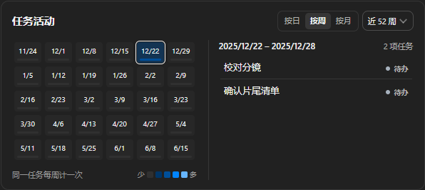

# MOKI Taskboard for DSH

[English](README.md) · [简体中文](README.zh-CN.md) · [Releases](https://github.com/JKZeng-cell/moki-taskboard-for-dsh/releases)

**Windows · DSH plugin v0.1.12 · MIT**

Keep the brief, input files, agent session and deliverables on one task card. For a field-guide project, queue the route translations, attach a sketch to the map task, then review the packing list alongside the files the agent delivered.

| When you want to… | Use Taskboard to… |
| --- | --- |
| Plan work | Group cards by status, from backlog through review and completion, or switch to a table. |
| Start an agent | Run a task now, queue it, or set a weekly work window. Resume a project session or start a new one. |
| Hand off inputs | Drop in files or paste screenshots. Each run records the input versions it actually received. |
| Review a delivery | Open the files, check the requirements, then accept the task or request another pass with comments and attachments. Earlier deliveries remain available. |
| Revisit progress | Link sessions within a chosen scope and follow the source conversation. Select a day, week or month to see which tasks changed. |

The project database and managed files live on your machine. Agent execution and optional semantic session matching send the relevant context through the host and model you select, using your account's model allowance.



## Install

Tested with DeepSeek Harness Desktop 0.2.2-rc.1 on Windows. Download the [0.1.12 package](https://github.com/JKZeng-cell/moki-taskboard-for-dsh/releases/download/v0.1.12/dsh-moki-taskboard-0.1.12.tgz), select the local tgz in the desktop plugin manager, or run the following from its download folder with the CLI for your desktop installation.

```powershell
$archive = (Resolve-Path '.\dsh-moki-taskboard-0.1.12.tgz').Path.Replace('\', '/')
dsh plugin --profile desktop add "dsh-moki-taskboard@file:$archive"
dsh plugin --profile desktop list dsh-moki-taskboard --depth 0
```
Reopen DSH and select MOKI Taskboard for DSH in the sidebar. Files open in the right-hand preview. Approval notifications take you to the originating DSH session. Scheduling and session capture require the host to be running.

[Adapter and buildable source for this release](https://github.com/JKZeng-cell/moki-taskboard/tree/v0.2.23/ports/dsh) · [Build instructions](https://github.com/JKZeng-cell/moki-taskboard/tree/v0.2.23)

[项目配图与文案 · Launch media kit](https://github.com/JKZeng-cell/moki-taskboard/tree/v0.2.23/media/launch)
