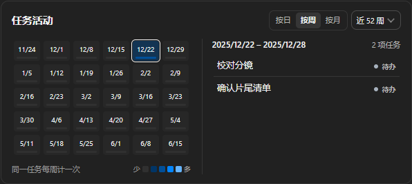

# MOKI任务台 for DSH

[English](README.md) · [简体中文](README.zh-CN.md) · [Releases](https://github.com/JKZeng-cell/moki-taskboard-for-dsh/releases)

**Windows · DSH plugin v0.1.12 · MIT**

同一项工作常常散在几段对话里。MOKI 把任务说明、所用附件、执行会话和交付物放在一张卡上。以制作一本春季徒步手册为例，可以先把路线翻译排进队列，给地图绘制附上草图，再打开校对任务逐项验收。

| 工作环节 | 可以怎么用 |
| --- | --- |
| 拆任务 | 在看板上分列管理待办、队列、进行中、待验收、完成、暂停和错误。也可以切到表格。 |
| 启动 Agent | 立即执行、按队列运行，或限定到每周时段。可自动匹配会话、指定项目内已有会话，或新开会话。 |
| 准备资料 | 将文件或截图拖入任务，执行时固定输入版本。之后更新原文件，仍可查到当时使用的版本。 |
| 验收与返工 | 在任务里预览交付物，检查必交文件；需要调整时点「继续优化」，带上新意见和附件，再比较两轮交付。 |
| 找回项目进展 | 可按授权范围关联会话，从状态判定跳回原话；用日、周、月活动视图查看有变化的任务。 |

项目库和托管文件保存在本机。启动 Agent 或启用语义归集时，相关任务内容会由所选宿主和模型处理，并使用该账号的模型额度。



## 安装

适配 Windows DeepSeek Harness Desktop 0.2.2-rc.1。下载 [0.1.12 安装包](https://github.com/JKZeng-cell/moki-taskboard-for-dsh/releases/download/v0.1.12/dsh-moki-taskboard-0.1.12.tgz)，在桌面插件管理器选取本地 tgz，或在下载目录使用对应桌面版的 CLI 执行以下命令。

```powershell
$archive = (Resolve-Path '.\dsh-moki-taskboard-0.1.12.tgz').Path.Replace('\', '/')
dsh plugin --profile desktop add "dsh-moki-taskboard@file:$archive"
dsh plugin --profile desktop list dsh-moki-taskboard --depth 0
```
重新打开 DSH，从侧栏进入「MOKI任务台 for DSH」。点击资产可在任务台右侧预览；遇到执行审批，从提醒跳入对应的 DSH 会话处理。时段调度与归集需要 DSH 宿主运行。

[本版适配器与可复现构建源码](https://github.com/JKZeng-cell/moki-taskboard/tree/v0.2.23/ports/dsh) · [构建步骤](https://github.com/JKZeng-cell/moki-taskboard/tree/v0.2.23)

[项目配图与文案 · Launch media kit](https://github.com/JKZeng-cell/moki-taskboard/tree/v0.2.23/media/launch)
