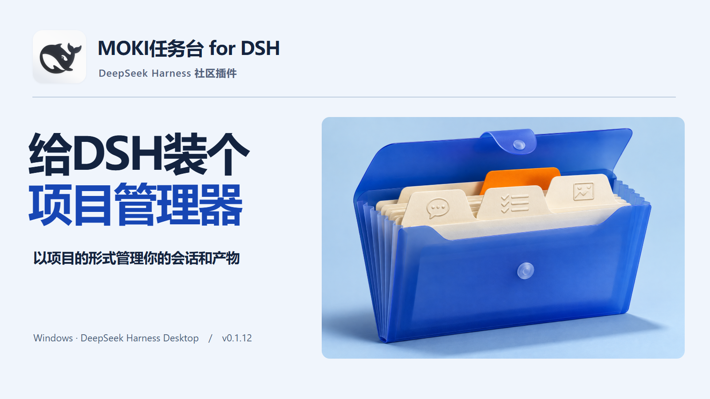

# 给DSH装个项目管理器

以项目的形式管理你的会话和产物

[官方社区展示帖 #13890](https://github.com/deepseek-ai/deepseek-harness/discussions/13890) · [下载发布物料 ZIP](https://github.com/JKZeng-cell/moki-taskboard-for-dsh/releases/download/v0.1.12/moki-taskboard-for-dsh-xhs-0.1.12.zip) · [小红书正文与话题](小红书文案.txt)

## 小红书轮播顺序

| 顺序 | 图片 |
| --- | --- |
| 1 | [竖版封面](carousel/01-cover.png) |
| 2 | [从项目总览进入看板](carousel/02-project.png) |
| 3 | [会话归集与来源原话](carousel/03-chats.png) |
| 4 | [带附件快速建卡](carousel/04-quick.png) |
| 5 | [资产版本与右侧预览](carousel/05-preview.png) |
| 6 | [核对交付物并验收](carousel/06-review.png) |
| 7 | [DSH 桌面安装及下载二维码](carousel/07-install.png) |

七张轮播图均为 1080 × 1440 PNG。横版发布封面为 1600 × 900 PNG，适用于社区帖和发布页。[图集预览](preview.jpg) · [素材来源](素材来源.md)
